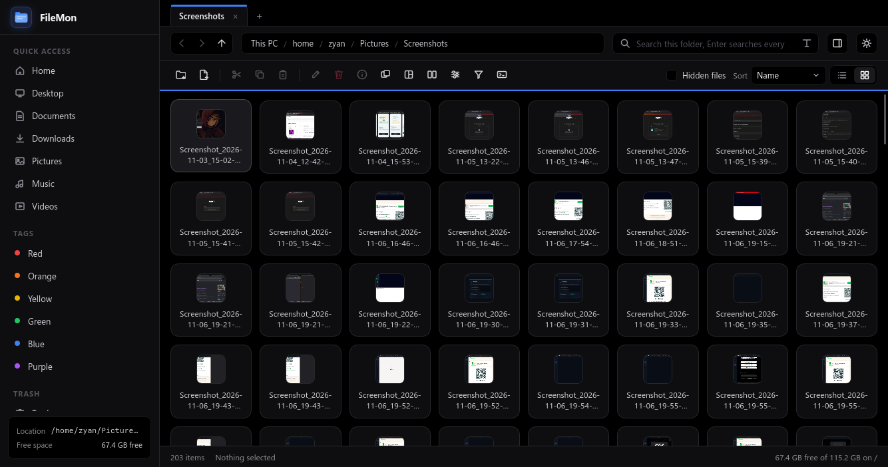
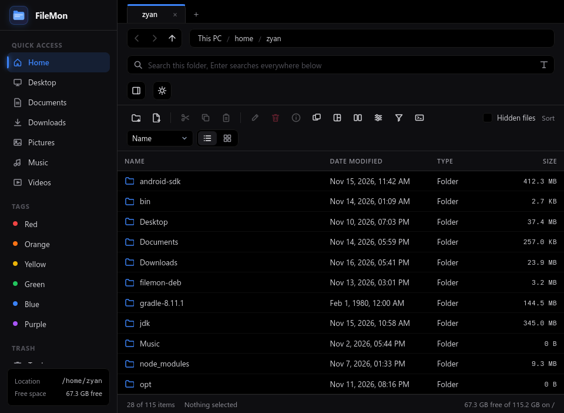

# FileMon

[](https://github.com/zulian026/filemon/releases/latest)
[](LICENSE)
[](https://github.com/zulian026/filemon/releases/latest)
[](https://v2.tauri.app/)
[](https://www.rust-lang.org/)

FileMon is a Windows Explorer-style file manager for Linux, built with [Tauri v2](https://v2.tauri.app/) and Rust. Browse folders, manage files, and preview what is inside — in one window, with no background daemon.



## Features

### Browsing

- **Explorer shell** — sidebar with Quick access, Trash, and drives; breadcrumbs; back/forward/up navigation with history.
- **Two views** — details table (name, date modified, type, size, sortable) and icon grid. The choice is remembered per tab.
- **Tabs** — each tab keeps its own folder, history, view, and sort. Ctrl+T opens a tab, Ctrl+W closes it, Ctrl+Tab cycles, middle-click closes, Ctrl+double-click opens a folder in a new tab. Ctrl+Shift+T reopens the last closed tab, with its old view and sort. Tabs and the active pane are restored on launch.
- **Address bar** — Ctrl+L swaps the breadcrumbs for an editable path: type a folder (a leading `~` expands to Home, a relative path resolves against the current folder), Enter jumps there, Esc puts the breadcrumbs back.
- **Advanced filters** — the funnel button in the toolbar filters the listing by type (folders, images, video, audio, documents, archives, code, other), extension, size range, and modified-date range. Folders count by their computed size.
- **Dual pane** — Ctrl+Shift+D splits the file area into two independent panes, each with its own tabs and folder. Click a pane to make it active (Alt+1 / Alt+2 also work); F5 copies the selection to the other pane, F6 moves it. Dragging between panes works too.
- **Compare folders** — in dual pane, right-click and choose "Compare with other pane": the active pane lists what exists only here, only there, and what differs (same name, different size or content; folders with the same name are not recursed into). Two buttons copy the missing files either way, then the compare refreshes.
- **Quick access pins** — right-click any folder and pin it to the sidebar. Pins survive restarts; folders that no longer exist are pruned on launch.
- **Folder sizes** — the Size column shows real folder sizes, computed in the background so the listing never blocks. Selecting a folder adds its size to the status-bar total. Sorting by Size orders folders among files by their computed size.
- **Image thumbnails** — the icon grid shows real previews of image files, loaded lazily with a generic icon as fallback. Thumbnails are downscaled and cached on disk under `~/.cache/filemon/thumbs`, keyed by path, size, and modification time, so a revisited folder does not regenerate them; an edited file re-renders.
- **Video thumbnails** — the first frame of a video file, extracted by ffmpeg (in-page `<video>` is avoided: this WebKitGTK crashes its web process on any `<video>` load, GStreamer autoaudiosink missing), and cached on disk the same way. Graceful icon fallback when ffmpeg or the file fails.
- **Icons per file type** — every file kind gets its own icon: images, videos, audio, documents, spreadsheets, presentations, archives, applications, code, and text files. Symlinks get a link icon.
- **Group by** — group the listing by type, date, or size, with collapsible headers that show the item count. Per tab, set from the Appearance panel.
- **Drive usage bars** — each drive in the sidebar shows a bar of used space and its free space; the bar turns red at 90% used.

### Appearance

- **Appearance panel** — the sliders button in the toolbar opens one panel for Group by, density, interface scale, and icon-grid size.
- **Grid zoom** — Small / Medium / Large tiles per tab, or Ctrl+scroll / Ctrl+= / Ctrl+− in the icon grid.
- **Density** — Compact or Comfortable row spacing, remembered.
- **Interface scale** — 90% / 100% / 110% / 125% UI zoom, remembered.
- **Quick Look** — press Space on a single selected file for a large preview (image, video first frame, PDF first page, highlighted code, folder summary); Left/Right step through the folder, Esc or Space closes. Also in the right-click menu.
- **Empty state** — an empty folder shows a large folder icon, a short explanation, and a New folder button; a search with no matches offers to clear the search.

### File operations

- **Copy, cut, paste, rename, new folder, new file** — with a progress panel for large transfers (chunked copies, cancel support) and a **Compress to ZIP / Extract here** pair with zip-slip protection.
- **Batch rename** — rename many files at once with find/replace, prefix, suffix, and numbering, with a live old → new preview and collision check.
- **Open With** — right-click a file to open it with any application that handles its type; tick "Always use the chosen app for this file type" to make it the default (xdg-mime). Copy Path copies the selected paths.
- **Properties** — the Properties dialog shows type, location, size, and modification date, plus an octal permission editor (Apply runs chmod) and the file's SHA-256, computed after the dialog opens so a large file never delays it, with a Copy button.
- **Trash** — deleting moves files to the freedesktop Trash. Restore them, delete them permanently, or empty the whole Trash from the sidebar.
- **Drag & drop** — drag files onto folders, breadcrumbs, sidebar items, tabs, or the Trash. Dropping files in from another app copies them into the current folder. Dragging a file out of FileMon offers it to other apps as file URIs.
- **Find duplicates** — scans the current folder tree for files with identical content (size, then hash, then byte comparison) and lets you delete all but the first of each group.
- **Open in Terminal** — right-click a folder, a file, or empty space to open a terminal at that location. It honours `$TERMINAL`, then tries foot, Alacritty, Kitty, WezTerm, Ghostty, GNOME Terminal, Konsole, and others.

### Search and preview

- **Search** — instant name filter of the current folder; Enter searches recursively below it. The T button in the search box switches to content search, which finds text inside files and shows the matching line.
- **Preview pane** — image preview (click to toggle actual size, dimensions shown), text preview with line numbers and syntax highlighting for code, Markdown files rendered as formatted text, archive contents listed without extracting, and PDF first page rendered by the built-in viewer; folder summary otherwise.

### Keyboard

Arrows move the selection (a full row in Icons view), Left/Right step one tile, Home/End jump to first/last, PageUp/PageDown move a screen, Enter opens. Hold Shift with any of them to extend the selection as a range. Alt+Left/Right go back/forward, Alt+Up and Backspace go up a level, Ctrl+C/X/V copy/cut/paste, Delete deletes, F2 renames, Ctrl+F focuses search, Ctrl+H toggles hidden files, Ctrl+L focuses the address bar, Ctrl+T opens a tab, Ctrl+W closes it, Ctrl+Shift+T reopens the last closed tab. Space opens Quick Look on the selected file. In dual pane: Ctrl+Shift+D toggles it, Alt+1/Alt+2 switch the active pane, F5 copies the selection to the other pane, F6 moves it. In the icon grid: Ctrl+scroll or Ctrl+= / Ctrl+− changes the tile size.



## Installation

Linux (x86_64) only. Get the latest release from the
[Releases page](https://github.com/zulian026/filemon/releases/latest) — each release ships the AppImage, the standalone binary, a `.deb` package, and a `.rpm` package.

**AppImage (recommended):**

```bash
chmod +x FileMon_0.1.1_amd64.AppImage
./FileMon_0.1.1_amd64.AppImage
```

**Debian package (Debian/Ubuntu):**

```bash
sudo apt install ./FileMon_0.1.1_amd64.deb
```

Installs `filemon` to `/usr/bin` with an app-menu entry; dependencies are pulled in automatically.

**RPM package (Fedora/openSUSE):**

```bash
sudo dnf install ./FileMon-0.1.1-1.x86_64.rpm
```

**Standalone binary:**

```bash
./filemon
```

On Arch / CachyOS there is no `dpkg` or `apt`, so install from the `.deb` payload manually:

```bash
mkdir -p ~/filemon-deb && cd ~/filemon-deb
ar x FileMon_0.1.1_amd64.deb
sudo tar -xzf data.tar.gz -C /
sudo update-desktop-database /usr/share/applications
sudo gtk-update-icon-cache /usr/share/icons/hicolor
```

## Usage

- **Navigate** — click a folder to enter it, use the breadcrumbs or the sidebar to jump. The back/forward buttons and Alt+arrows follow the per-tab history.
- **Tabs** — the tab bar sits above the toolbar. Ctrl+T duplicates the current tab, Ctrl+W closes it. Closing the last tab opens a fresh Home tab.
- **Trash** — deleted files land in Trash. Open Trash from the sidebar to restore or permanently delete them; Empty Trash clears it all. Items in Trash cannot be dragged out — Restore is the way back.
- **Transfers** — copying or moving large files shows a progress panel at the bottom right with a Cancel button. A cancelled cut keeps its clipboard.
- **Theme** — the top bar toggles dark (default) and light; the choice is remembered.

## Building from source

Prerequisites: [Node.js](https://nodejs.org/) 18+, a recent stable Rust toolchain ([rustup](https://rustup.rs/)), and the Tauri system dependencies for Linux.

```bash
# Ubuntu / Debian
sudo apt install libwebkit2gtk-4.1-dev build-essential curl wget file \
  libxdo-dev libssl-dev libayatana-appindicator3-dev librsvg2-dev \
  libgtk-3-dev libsoup-3.0-dev patchelf

# Arch / CachyOS
sudo pacman -S webkit2gtk-4.1 gtk3 libayatana-appindicator librsvg \
  base-devel patchelf libsoup3
```

```bash
git clone https://github.com/zulian026/filemon.git
cd filemon
npm install
npm run tauri dev    # dev: Vite on :1420 + Tauri window
npm run tauri build  # release: src-tauri/target/release/filemon
                     # bundles (AppImage, .deb, .rpm) under
                     # src-tauri/target/release/bundle/
```

Tests:

```bash
cd src-tauri
cargo test           # 24 tests: transfer engine, zip, trash, terminal detection, folder sizes, compare, archive, thumbnails, permissions
```

## Design

True-black-flat: ground `#000`, surface `#111`, lime `#c6f24e` only on data. No gradients, no shadows. Fonts are the system UI fonts (Adwaita Sans / Adwaita Mono, falling back to Noto Sans), no bundled webfonts. Two themes: dark (default) and light, toggled from the top bar and remembered in localStorage. In light mode the data accent is a darker lime green (`#65a30d`) so it stays readable on white. Icons are a single inline SVG set (16px, 1.5px stroke, currentColor). Layout is containment-first: every grid child has `min-width: 0`, tables use fixed layout with truncated name columns.

## Project structure

```
.
├── index.html               # Vite entry
├── package.json             # frontend deps (Vite, @tauri-apps/cli, @tauri-apps/api)
├── src/                     # frontend: main.ts, styles.css
├── src-tauri/
│   ├── Cargo.toml
│   ├── tauri.conf.json      # app metadata, version, bundle targets
│   ├── icons/               # app icons
│   └── src/                 # Rust backend
│       ├── fsops.rs         # listing, transfer engine, zip, trash, folder sizes
│       └── lib.rs           # Tauri commands and app setup
├── docs/
│   └── images/              # screenshots
└── release/                 # release binary (not committed)
```

## License

MIT
